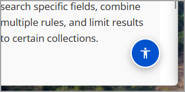
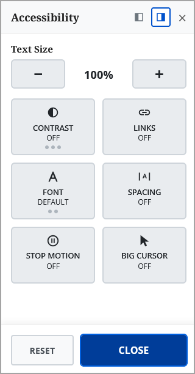
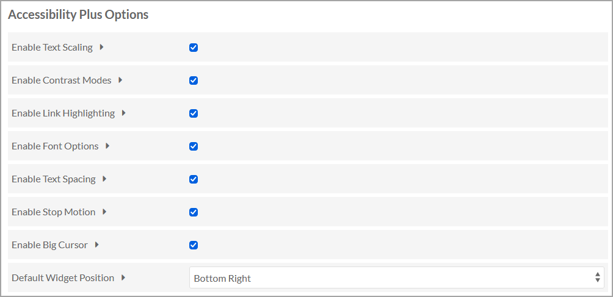

# Accessibility Plus

**Help more people read your collections.** Accessibility Plus lets visitors to your [Omeka S](https://omeka.org/s/) site enlarge the text, raise the contrast, switch to a dyslexia-friendly font, stop animations and more - and it works as soon as it's installed with no theme changes.

We put our collections online so that everyone can explore them. But "everyone" includes people who find a typical web page hard to read: someone with low vision who needs larger text, someone with dyslexia for whom a different font makes the words settle down, someone with migraines or a vestibular condition for whom moving content is genuinely unpleasant, or an older visitor who just finds small, low-contrast text tiring. Many people live with a disability, and many more have days when reading a screen is hard.

Accessibility Plus gives these visitors a simple way to make your Omeka S site work for them. A small floating button in the corner of every public page, a blue circle with the universal accessibility symbol, opens a panel where they can enlarge the text, change the contrast, switch to a more readable font, widen the spacing, stop animations or enlarge the mouse pointer. Their choices are remembered and applied on every page they visit, so they only have to set them once.



**Very little effort is needed to add this.** Install the module and the button appears on every public page straight away: no theme changes, no code, no accounts and no outside services. Choosing which tools to offer on each site takes a minute in the site settings. If you build or maintain your own theme, a few optional tweaks (see [Tips for theme developers](#tips-for-theme-developers)) make it work even better, but nothing is required.



## Features

| Tool | What it does |
|---|---|
| **Text Size** | Enlarges text from 100% to 200%, in steps of 10%. |
| **Contrast** | Cycles through High contrast, Invert and Grayscale. In High contrast and Invert, images and image viewers keep their normal colors; Grayscale turns the whole page gray, images included. |
| **Links** | Highlights every link on the page. |
| **Font** | Cycles through the site's own font, a readable font ([Atkinson Hyperlegible](https://www.brailleinstitute.org/freefont/)) and a dyslexia-friendly font ([OpenDyslexic](https://opendyslexic.org/)). Both fonts are included with the module, so nothing is loaded from other websites. |
| **Spacing** | Widens line, letter and word spacing (the values from [WCAG 1.4.12 Text Spacing](https://www.w3.org/WAI/WCAG22/Understanding/text-spacing.html)). |
| **Stop Motion** | Stops animations, transitions and smooth scrolling (see [WCAG 2.2.2 Pause, Stop, Hide](https://www.w3.org/WAI/WCAG22/Understanding/pause-stop-hide.html)). |
| **Big Cursor** | Enlarges the mouse pointer. Hidden on touch screens. |

* Each tool can be turned on or off per site.
* The button floats over the page, so it never takes up space in your layout. It always looks the same, a blue circle with the universal accessibility symbol, consistent with other accessibility tools, so visitors who rely on them recognize it straight away. It deliberately doesn't take on your theme's colors.
* Visitors can move the button to the bottom left or bottom right corner, and reset everything with one click.
* The panel works with a keyboard (Tab, Enter, Escape) and screen readers announce each change.
* Saved choices are applied before the page is drawn, so pages don't flash at the default size first.
* The panel's own animations follow the visitor's system ["reduce motion" setting](https://developer.mozilla.org/en-US/docs/Web/CSS/@media/prefers-reduced-motion).
* The panel uses the site's own fonts.

## Requirements

* Omeka S 4.0 or later
* No other modules are needed.

## Installation

1. Download the zip file from the latest release.
2. Unzip it into your Omeka S `modules/` folder. The folder must be named exactly `AccessibilityPlus`.
3. In the Omeka S admin, go to **Modules** and click **Install** next to Accessibility Plus.

The button appears on every public page of every site straight away. Admin pages are not affected.

## Configuration

**Settings are site-specific.** Each site in your Omeka S install has its own Accessibility Plus settings, so you can, for example, offer every tool on one site and only some on another. There is no global setting, and the module has no Configure button on the Modules page.

For each site, go to **Site admin > Settings** and find the **Accessibility Plus Options** section:



* **Enable ...**: turn each tool on or off. If every tool is off, the button isn't shown on that site.
* **Default Widget Position**: the corner the button starts in (bottom right or bottom left). Visitors can still move it.

## Privacy

Visitors' choices are stored only in their own browser ([`localStorage`](https://developer.mozilla.org/en-US/docs/Web/API/Window/localStorage)). There are no cookies and no tracking, and nothing is sent to your server or anywhere else.

**Choices are saved per domain, not per site.** Browsers keep this storage separately for each web address, and all the sites in one Omeka S install share the same address (`/s/site-a/...`, `/s/site-b/...`). So:

* A visitor's choices apply to **every site on the same Omeka S install**: 150% text on one site is 150% on the others too.
* Installs on **different domains** (for example a test server and a live server) keep separate choices.
* Each **browser and device** has its own choices; a visitor on another computer starts from the defaults.
* If a tool is turned off on a site (see [Configuration](#configuration)), the visitor's saved choice for it is ignored on that site but still applies on sites where the tool is on.

## Limitations

* This module gives visitors reading preferences. It does not make a site accessible or compliant on its own (for example with the [Web Content Accessibility Guidelines, WCAG](https://www.w3.org/WAI/standards-guidelines/wcag/)), and it is not a substitute for accessible content and an accessible theme. Omeka's own [Accessibility Statement](https://omeka.org/s/docs/user-manual/accessibility/) describes how Omeka S approaches accessibility and includes planning tips for building an accessible site; the W3C's [Introduction to Web Accessibility](https://www.w3.org/WAI/fundamentals/accessibility-intro/) is a good place to start.
* **Text Size** works by changing the page's root font size. Text that your theme sizes in [`rem` or `em`](https://developer.mozilla.org/en-US/docs/Learn_web_development/Core/Styling_basics/Values_and_units) grows; text sized in `px` doesn't. Most current themes use `rem`/`em`.
* Contrast and spacing are applied over your theme's own styles, so a few theme elements may need small adjustments. See the tips for theme developers below.

## Tips for theme developers

None of this is required: the module works with most themes as it is. These tips help it fit your theme more closely.

### Quick checklist

1. **Size text in `rem` or `em`, not `px`.** Text Size works by changing the root font size, so only relative sizes grow. This is the single biggest improvement you can make, and it also helps visitors who zoom with their browser.
2. **Let Stop Motion stop your scripted motion too.** The module stops CSS animations, transitions and smooth scrolling by itself, but it can't stop motion driven by JavaScript, such as carousels, sliders, auto-playing video or parallax effects. Listen for the change event (below) and pause them.
3. **Respect the system "reduce motion" setting as well**, with [`@media (prefers-reduced-motion: reduce)`](https://developer.mozilla.org/en-US/docs/Web/CSS/@media/prefers-reduced-motion). Some visitors set it once for all websites and never open the panel.
4. **Check your layout at 200% text.** Make sure menus, headers and buttons wrap instead of overlapping or being cut off. Fixed heights (`height: 40px`) on elements that contain text are the usual cause.
5. **Try each Contrast mode and the two fonts** on your main pages. If something looks wrong, fix it with the classes below.
6. **Keep the bottom corners clear,** or choose the corner your theme doesn't use (Default Widget Position). The button sits at `z-index` 999998 so it stays above most content.

### Classes on `<html>`

While a tool is active, a class is added to the `<html>` element. It's added in `<head>`, before the page is drawn, so CSS based on these classes never flickers.

| Tool | Class |
|---|---|
| Text Size | `ap-text-110` ... `ap-text-200` |
| Contrast | `ap-contrast-high`, `ap-contrast-invert`, `ap-contrast-grayscale` |
| Links | `ap-links-highlight` |
| Font | `ap-font-readable`, `ap-font-dyslexic` |
| Spacing | `ap-spacing-on` |
| Stop Motion | `ap-motion-stop` |
| Big Cursor | `ap-cursor-big` |

Use them to adjust your theme for a tool, for example:

```css
/* Hide a decorative video background when motion is stopped */
html.ap-motion-stop .hero-video { display: none; }

/* Give a fixed-height header room to grow at larger text sizes */
html[class*="ap-text-"] .site-header { height: auto; }
```

The module's own overrides use `!important`, so to change how a tool affects one of your elements, use `!important` in your rule as well.

### The change event

When a visitor changes a setting, and once when the page loads, the module fires an `AccessibilityPlus:change` event on `document`. Use it for anything CSS can't do, such as pausing a carousel:

```javascript
document.addEventListener('AccessibilityPlus:change', function (event) {
    if (event.detail.motion) {
        myCarousel.pause();
    } else {
        myCarousel.play();
    }
});
```

`event.detail` holds the current settings:

| Property | Values |
|---|---|
| `textScale` | `100` to `200` |
| `contrast` | `'none'`, `'high'`, `'invert'`, `'grayscale'` |
| `font` | `'default'`, `'readable'`, `'dyslexic'` |
| `links`, `spacing`, `motion`, `cursor` | `true` or `false` |

Because the event also fires on page load, one handler covers both the visitor's saved choice and later changes. To check a setting at any other time, test the `<html>` class instead, e.g. `document.documentElement.classList.contains('ap-motion-stop')`.

### What the module leaves alone

* In High contrast and Invert, images, videos, `<canvas>`, `<iframe>`s and image viewers built on [OpenSeadragon](https://openseadragon.github.io/) keep their normal colors, so photographs and documents look as they should. (Grayscale deliberately turns everything gray.)
* Icon fonts (Font Awesome, Material Icons and anything with `icon` in its class), `code`, `pre` and `kbd` keep their own font, so icons don't turn into letters.
* [Tabulator](https://tabulator.info/) tables get their own text-size adjustments, because they set font sizes in pixels.
* Admin pages are never affected.

## Translations

Accessibility Plus speaks the same languages as Omeka S itself. Translations are included for all 31 languages that Omeka S ships with:

Arabic, Basque, Bulgarian, Catalan, Chinese (Simplified and Traditional), Croatian, Czech, Dutch, Estonian, Finnish, French, German, Greek, Hungarian, Italian, Japanese, Korean, Lithuanian, Mongolian, Polish, Portuguese (Brazil and Portugal), Romanian, Russian, Serbian, Spanish (Spain and Latin America), Swedish, Turkish and Ukrainian.

Omeka uses the right one automatically, following each site's language setting (and, in the admin, each user's language). The visitor panel, its screen-reader announcements and the site settings are all translated.

These translations were machine-generated and haven't yet been checked by native speakers. They should read clearly, but they may not always choose the most natural word. If you're a native speaker and a phrase sounds a little off, a correction would be very welcome: open an issue with the better wording, or edit the language's `.po` file in a pull request. Even a single improved phrase helps.

**Fonts and other writing systems.** The two bundled fonts, Atkinson Hyperlegible and OpenDyslexic, are designed for Latin-script languages. On sites in Arabic, Bulgarian, Chinese, Greek, Japanese, Korean, Mongolian, Russian, Serbian or Ukrainian, choosing Readable or Dyslexic falls back to a standard system font, so that option makes less difference there.

**Adding a language.** To add another language, copy `language/template.pot` to `language/<locale>.po` (for example `ga.po`), translate it with a tool such as [Poedit](https://poedit.net/), and save the compiled `<locale>.mo` file in the same folder. Anything not translated stays in English.

## Uninstalling

Uninstalling the module removes its settings from every site. Visitors' saved choices stay in their own browsers but are no longer used.

## Support

Accessibility Plus is provided as-is. Your feedback helps make this better for everyone. If you’ve run into an issue or have a suggestion to share, we’d love to hear it! Our volunteer team will do our absolute best to help out.

To report a problem or suggest an idea, open an issue on this repository's **Issues** tab. Please include:

* the address (URL) of a page where the problem happens, if the site is public,
* your Omeka S and PHP versions,
* the theme your site uses,
* the browser (and device, if it's a phone or tablet),
* what you did, what you expected, and what happened instead, with any error message or a screenshot.

Fixes and improvements are welcome as pull requests.

## License and credits

* The module is licensed under the [GNU General Public License v3](LICENSE).
* The module is provided "as is", without warranty of any kind. You use it at your own risk; the authors are not liable for any damages arising from its use (see sections 15–16 of the GPLv3).
* Atkinson Hyperlegible, © Braille Institute of America, and OpenDyslexic, © Abbie Gonzalez, are included under the [SIL Open Font License 1.1](https://openfontlicense.org/). Their license texts are in `asset/fonts/`.
